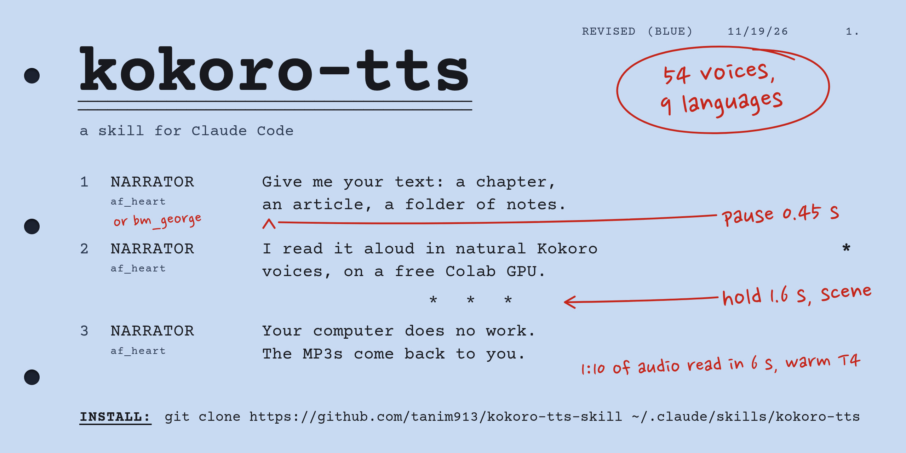

<p align="center"></p>

# kokoro-tts

**A [Claude Code](https://code.claude.com/docs/en/overview) skill that turns text into natural spoken audio, using the open-source [Kokoro](https://huggingface.co/hexgrad/Kokoro-82M) voices on a free Google Colab GPU.** Your own computer does no work.

You give Claude some text: a file, a folder of chapters, or a paragraph in the chat. Claude builds one self-contained Python cell, opens Google Colab in your Chrome, pastes and runs the cell on a free T4 GPU, waits for the narration, and brings the MP3s back to you. You sign in to Google, pick a voice, and listen.

It has narrated a 46-file novel in two voices. A 70-second sample takes about 6 seconds on a warm GPU.

## What you say

The skill loads by itself when you ask for audio. For example:

- "Narrate `drafts/chapter-05.md`."
- "Read this aloud for me: …"
- "Make an audiobook of every markdown file in `notes/`, British voice."
- "Text to speech for this article, both voices, put the files on my Drive."

You can also call it by name: `/kokoro-tts`, or "use the kokoro-tts skill to …".

## How it works

1. **Build.** `scripts/build_cell.py` cleans the text for speech (markdown removed, headings read as sentences, links read as their text, code blocks skipped), then packs the text and the job list into one Python cell, compressed. Big jobs are split into several cells.
2. **Paste and run.** Using the [Claude in Chrome](https://claude.com/claude-in-chrome) extension, Claude opens your Colab notebook in a new tab, puts the cell on the clipboard, pastes it with one keystroke, checks that the pasted length matches, and runs it.
3. **Narrate.** In Colab, the cell installs Kokoro if it's missing, checks for a GPU, and reads each text: a title line, then each paragraph, with pauses between paragraphs and longer ones at scene breaks. Every file is delivered as soon as it's finished, and a skip list lets a rerun carry on where it stopped.
4. **Watch and bring back.** Claude watches for the files on your side (not with screenshots), then clears the cell, closes the tab, and tells you what came back.

The first time, Claude asks you to sign in to Google in Chrome, then creates a notebook called `kokoro-tts.ipynb` in your Drive and sets it to a free T4 GPU, with your OK. It remembers that notebook in `~/.config/kokoro-tts/config.json`, on your machine only.

## Requirements

- [Claude Code](https://code.claude.com/docs/en/overview).
- Google Chrome with the [Claude in Chrome](https://claude.com/claude-in-chrome) extension, connected to Claude Code.
- A Google account that can use Colab. The free tier is enough.
- Python 3.9 or newer with Tk (for the clipboard helper). On Debian or Ubuntu: `sudo apt install python3-tk`. Nothing else: the scripts use only the standard library.
- Optional: `ffprobe` (from ffmpeg) to check the durations of the files that come back.

Tested on Linux (X11). macOS and Windows should work, since Tk handles the clipboard there too (on a Mac the skill uses cmd instead of ctrl), but they haven't been tested yet.

## Install

```bash
git clone https://github.com/tanim913/kokoro-tts-skill ~/.claude/skills/kokoro-tts
```

Start a new Claude Code session and ask for some audio. To check the scripts offline first:

```bash
python3 -I ~/.claude/skills/kokoro-tts/scripts/selftest.py
```

## Choices

| | Default | Change it by saying… |
|---|---|---|
| Voices | `af_heart` (American) and `bm_george` (British): two files per text | "in bf_emma", "American voice only", or "let me audition voices first" |
| Title | read from the first heading (`# 4 \| Name` reads "Chapter 4. Name.") | "no title", or a template like "Chapter {n}. {title}." |
| Pauses | 1.2 s after the title, 0.45 s between paragraphs, 1.6 s more at a scene break (`* * *`, `---`) | "longer pauses between paragraphs" |
| Speed | 1.0 | "a little slower" (0.9) |
| Audio | MP3, mono, 48 kbps, 24 kHz (about 360 KB a minute) | "higher bitrate" |

If you don't name voices, Claude asks. Kokoro has 54 voices in 9 languages: American and British English, Spanish, French, Hindi, Italian, Japanese, Brazilian Portuguese and Mandarin. See [references/voices.md](references/voices.md).

### Where the files go

Pick one per run. Claude asks if you don't say.

| Delivery | How | Asks you first because |
|---|---|---|
| **zip** | One zip per cell downloads through Chrome when the cell ends; Claude unpacks it into `~/kokoro-tts/<run>/audio/`. | It's a download. Chrome may also ask where to save. |
| **drive** | Files land in `My Drive/kokoro-tts/<run>/` one by one, and survive a lost runtime. | Colab has to mount your Drive. |
| **put** | Files upload one by one to pre-signed URLs from your own app's storage. | (Your app's adapter sets this up.) |

## Using it from your own app

A project with its own storage can plug in two small local scripts: an **export** that writes the texts and per-file signed upload URLs, and a **record** that notes what arrived. Your secret keys stay in those local scripts and never go into the notebook. See [references/adapters.md](references/adapters.md) and a complete Supabase Storage example in [references/example-supabase.md](references/example-supabase.md).

## Privacy and safety

- **Your account, your browser.** Everything runs in your own Google account, in your own Chrome. Claude never types your passwords; if Colab asks you to sign in, you do it.
- **No secrets in the notebook.** The cell holds your text and, for app uploads, only publishable keys and signed URLs. The builder refuses to make a cell that contains a secret key, service-role token, `sk-` key, GitHub or Slack token, private key or password.
- **It asks first** before a download, before mounting your Drive, before creating the notebook or changing its runtime, and before using a different Google account.
- **It tells you what the notebook held.** The cell carries the full text being narrated, and Colab saves notebooks to Drive with their revision history. After each run Claude clears the cell and its output and tells you plainly what text went in. Older versions stay in Drive's revision history.

## Limits

- **Free GPU time is limited.** Colab doesn't publish the daily allowance. When it runs out, the cell stops with `KOKORO_NO_GPU`; nothing is lost, and the run resumes later from where it stopped.
- **Speed.** About 12 minutes of audio per GPU minute on a warm T4. A fresh runtime first spends a minute or two on installs and Kokoro's 330 MB download.
- **Cell size.** Cells of 250,000 characters paste fine. The skill keeps cells to 30,000 characters for zip delivery (a lost runtime loses an unfinished zip) and 60,000 for drive and put (about 22,000 words). See [references/limits.md](references/limits.md).

## What's in here

```
SKILL.md                     the instructions Claude follows
scripts/build_cell.py        text in, pasteable Colab cells out
scripts/cell_template.py     the code that runs in Colab
scripts/clip.py              holds a cell on the clipboard for the paste
scripts/watch.py             waits for the files on your side
scripts/config.py            your notebook link and account, kept in ~/.config
scripts/selftest.py          offline tests with a stand-in for Kokoro
references/                  Colab steps, voices, limits, adapters
evals/                       test cases (runnable with `claude plugin eval`)
assets/cover.html            the cover above, as HTML/CSS
```

## Troubleshooting

- **"Claude in Chrome isn't connected."** Open Chrome, make sure the extension is on and connected to Claude Code, and ask again.
- **The paste check fails.** Claude pastes again automatically. If it keeps failing, check that `python3 -c "import tkinter"` works.
- **No GPU.** Free quota used up, or the notebook's runtime type isn't T4 (Runtime, Change runtime type). Try again in a few hours.
- **The zip never shows up.** If Chrome asked where to save it, the watcher searches your home folder for it. Saving it in Downloads is quickest.

## Credits

Kokoro-82M by hexgrad (Apache 2.0) does the speaking, with [misaki](https://github.com/hexgrad/misaki) and espeak-ng for pronunciation, and ffmpeg for the MP3s. Google Colab provides the GPU. This project isn't affiliated with Google or with the Kokoro authors.

## License

[MIT](LICENSE)
